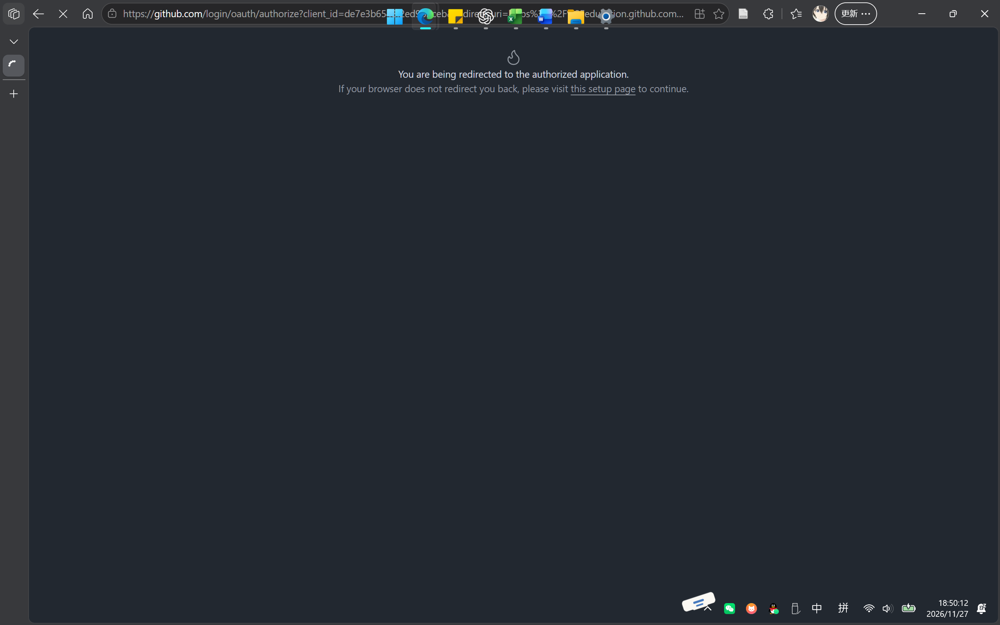
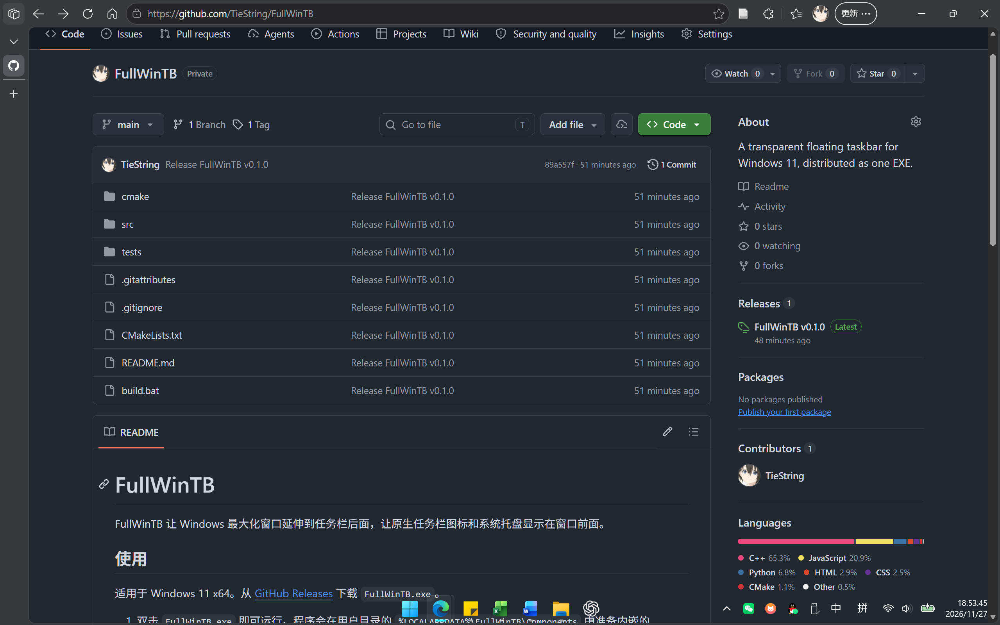

<p align="center">
  
</p>

<h1 align="center">FullWinTB</h1>

<p align="center">FullWinTB 让 Windows 最大化窗口延伸到任务栏后面，让原生任务栏图标和系统托盘显示在窗口前面。</p>

<p align="center">
  <a href="https://github.com/TieString/FullWinTB/releases/latest/download/FullWinTB.exe"><kbd>下载 FullWinTB.exe</kbd></a>
</p>

## 截图





## 使用

适用于 Windows 11 x64。从 [GitHub Releases](https://github.com/TieString/FullWinTB/releases/latest) 下载 `FullWinTB.exe`。

1. 双击 `FullWinTB.exe` 即可运行。程序会在用户目录的 `%LOCALAPPDATA%\FullWinTB\Components` 中准备内嵌的 Explorer 组件。
2. 首次打开即启用 FullWinTB，之后启动时恢复上次选择的启用或禁用状态。托盘菜单提供启用或禁用、刷新、设置和退出。默认快捷键 `Alt+Shift+A` 可以切换启用状态，也可以从设置中更换快捷键。
3. 任务栏背景保持透明。默认的「自动黑白配色」分别根据通知区和应用图标区的背景亮度，调整文字和透明底黑白单色图标。明暗混杂时沿用当前配色。设置中也可以选固定白字、固定黑字或跟随系统。
4. 普通最大化时任务栏继续浮动。应用进入占满屏幕客户区的全屏模式时，任务栏让出该屏，退出全屏或切换到窗口模式的应用后恢复。识别到 Windows、微信或 QQ 等应用的全屏截图遮罩时，实时任务栏也会暂时隐藏。

常驻悬浮适用于关闭 Windows 任务栏自动隐藏的配置。主屏任务栏按实际按钮和通知区边界保留点击区域，两者之间确认的空白处可直接点击背后的应用。图标进出时，FullWinTB 会等动画稳定后收窄点击区域。开启 Windows 高对比度时，任务栏使用系统配色。

### 移开浮动图标

在应用图标区或通知区上滚动鼠标，当前组会按设置中的「滚轮方向」滑出，每格默认移动 32 个逻辑像素。图标停稳后，指针位于原位和新位置围成的矩形内时会保持位置。移出后开始计时，默认停留 1.2 秒，再自动归位。计时期间移回矩形会取消倒计时，下次移出重新计时。

按住 Win 图标拖动应用区，按住右侧隐藏图标箭头拖动通知区。手势起步时自动锁定为上下或左右，每组可以分别移动。轻点仍会打开开始菜单或隐藏图标面板。鼠标附近的图标先动，移动得越快倾斜越明显，停下来就回正。Windows 的动画效果开关也控制这个倾斜。

两个方向都使用同款贴纸，分别斜贴在 Win 图标和托盘箭头的左上角。轻点贴纸可以固定或松开图标组。拖着贴纸揭开时图标停在原处，松开鼠标后贴纸消失，图标开始归位。卷边由内置的 Sticker Forge 图像绘制。

拖动 Win 图标松手后，在移到新位置的 Win 图标上快速双击，也可以固定应用组。滚动后把指针留在原处双击左键，会固定刚移动的那组。动作期间的单击会等待 Windows 的双击判定，再交给原窗口。

打开托盘的「设置…」，在「回弹手感」选择「弹性」或「简洁」。两种样式都同时用于上下和左右。弹性沿用现有的回拉曲线，触及屏幕边缘时向屏幕内回摆。简洁保留原来竖移到位即停的感觉。

点「试回弹」或拖动预览卡片可以比较手感。预设和质量、阻尼、近处吸合、远处回拉四项参数沿用 Feel。每格位移和停留时间在预览下方，轨迹和代码导出在「运动数据与导出」中。

在「常规」调整滚轮方向、任务栏文字或快捷键，也能手动归位。右上角可以切换简体中文和 English。回弹、语言和滚轮方向即时预览，点「保存」保留，点「取消」恢复打开时的参数。快捷键更改在确认快捷键时生效。

设置窗口使用系统的 Microsoft Edge WebView2 运行时。页面和脚本已内嵌，设置可离线打开。第三方许可可在设置窗口底部查看。

横移时，通知区向左碰到应用图标区会推着它一起走。通知区退开后，应用图标区会回到自己的位置。

在通知区开始连续滚动后，音量等系统图标滑到指针下面时也能继续推开通知区。停手或移开指针后，在音量图标上开始滚动即可使用系统音量调节。

竖移可用整个屏幕的可见行程。应用图标竖移时，原生缩略图随图标重新定位。隐藏图标面板贴着通知区展开，靠近屏幕边缘时，面板、箭头和展开动画会一同换向。固定位置在本次运行期间有效。移动适用于单屏的横向任务栏。

锁屏时暂停悬浮手势和窗口调整。桌面布局仍有效时，固定的图标组会留在贴住的位置。若解锁时需要重建布局，且屏幕尺寸、任务栏边缘及缩放相同，FullWinTB 会先恢复固定位置，再显示任务栏。

从 AuraBar 升级时，先退出旧程序，再启动 FullWinTB。旧设置会自动读入。如果退出旧任务栏美化工具后透明效果仍无法启用，重启资源管理器可以重新建立外观连接。

## 构建

需要 VS 2022 的 C++ 桌面开发工具、Windows 11 SDK、CMake 3.25 或更新版以及 Ninja。首次配置会获取固定版本的 WebView2 构建 SDK。已有解包的 SDK 时，可传入 `-DFETCHCONTENT_SOURCE_DIR_FULLWINTB_WEBVIEW2=<SDK 路径>`。使用 CMake 安装命令可生成供分发的单个 `FullWinTB.exe`。

```powershell
.\build.bat -DBUILD_TESTING=ON
ctest --test-dir build-out --output-on-failure
cmake --install build-out --prefix dist --config Release
```

需要检查实际 Win32 窗口和 Windows 截图遮罩时，可运行桌面回归。它会短暂打开专用窗口和截图遮罩。

```powershell
python .\tests\desktop_smoke.py --binary .\dist\FullWinTB.exe --snipping --vertical
```
